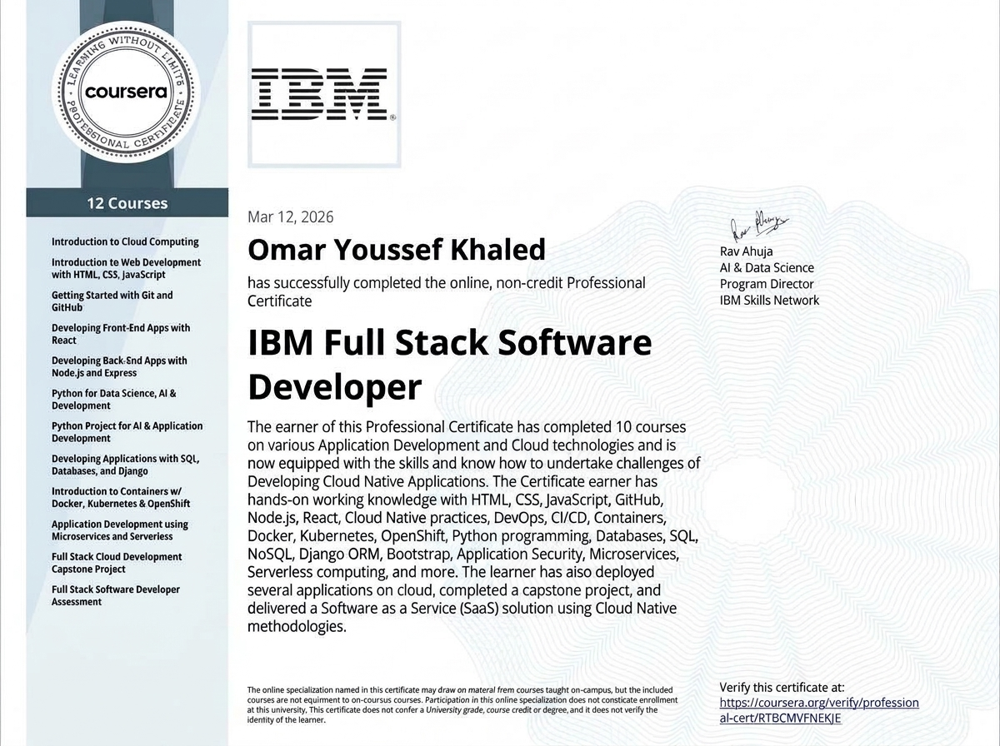

# IBM Full Stack Software Developer Professional Certificate - Omar Youssef

I'm enrolled in an IBM course on Coursera called "[IBM Full Stack Software Developer Professional Certificate](https://www.coursera.org/professional-certificates/ibm-full-stack-cloud-developer)." There are 12 sub-courses in this professional course. I created this repository so that I may share my course certificates & assignments.

